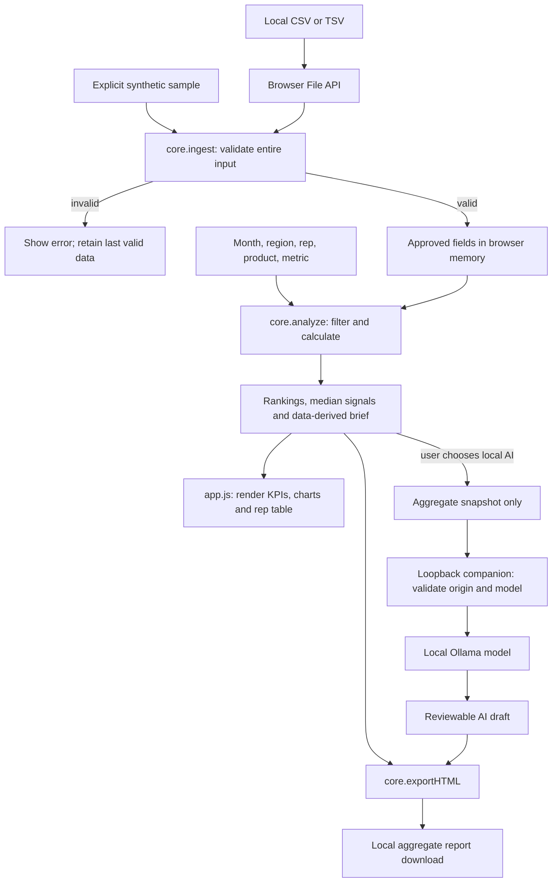

# Architecture and logic flow

## Components

| Component | Responsibility |
|---|---|
| index.html / style.css | Dashboard structure, responsive layout, controls, privacy guidance |
| app.js | In-memory state, file reads, filters, UI rendering, request lifecycle, clipboard and downloads |
| core.js | Parsing, validation, metrics, rankings, peer signals, deterministic narrative, safe HTML report generation |
| server.py | Optional local static server and aggregate-only AI bridge |
| data/generate.cjs | Reproducible synthetic input and example report |
| tests/ | Node rule tests and Python companion tests |

## Data flow

## Browser state and lifecycle

The controller owns the current approved dataset, filtered result, selected metric, optional draft, and current Blob URL. Ingestion completes before the approved dataset is replaced. Labels are rendered as text rather than executable markup.

A filter/metric change recalculates the current/prior snapshots and discards the old AI draft. AI generation tickets and AbortController prevent a late response from attaching to a different filter scope. Import tickets invalidate a pending file read when another import/sample/clear action supersedes it.

Clear data drops the active arrays and aggregate result, removes derived text/DOM content, empties filter options, revokes the report Blob URL, and invalidates pending work. This is session cleanup, not secure erasure of OS memory or previously downloaded files.

## Calculation decisions

- Monetary source values are parsed as integer cents before summation. Average values can be fractional cents internally.
- The same dimension filters apply before both month snapshots are selected.
- Prior-month presence is tracked separately from the prior value, so an absent dataset is not misreported as zero sales.
- Group averages use each group's won sum/count. Missing averages sort below defined values.
- The peer median uses defined selected-metric values from observed reps. Reps with no wins are flagged separately, even when their average is undefined.
- Winning ties are preserved; long display lists are abbreviated only in the narrative and some visual panels. The report contains every group.

## Privacy boundaries

Ordinary uploads never leave the browser for parsing or analysis. The optional AI request contains only a calculated brief, totals, grouped names/values, month, and metric. Raw IDs and deal records are absent. Aggregates still carry confidential information.

The companion binds to 127.0.0.1, checks Host/Origin, allows only named static routes, suppresses request logging, limits request/response sizes, and checks reported model metadata before sending aggregate content. It cannot verify the internal behavior of an externally configured model proxy.

The downloaded report escapes labels and AI text, embeds no JavaScript, and forbids external resources through its content policy. Sharing is a user's explicit file-distribution step, not an automatic cloud upload.

## Runtime and tests

The dashboard is buildless. Browser-independent business rules in core.js are exposed as SalesCore in the browser and CommonJS exports in Node. Python is only needed for the optional companion and its tests. Node is only needed for test/data-generation tasks. See README.md for commands and TESTING.md for observed verification and open limits.
